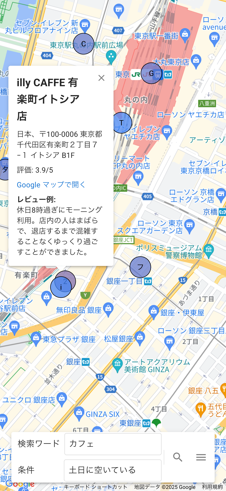

# maps_llm

## What is it?

Open `/`, move the Google map to the area you want to explore, and start your search in chat. All area searches start there. The label on the chat input shows what your next message applies to:

- **Map:** Ask `電源があるカフェ` (cafés with power outlets). One Google Places search fetches up to 20 candidates and their reviews in the current viewport. Pin colors show how well each place matches your criterion. Insufficient evidence means no score.
- **Current candidates:** Change the criterion to `静かに読書できる` (quiet enough to read). The app ranks the same places using the reviews already fetched, without another Places search.
- **Selected branch:** Ask `電源はどの席にある？` (which seats have power outlets?). Open the sources to read the branch reviews behind the answer.

To see walking times, center the map at your starting point and ask in chat: 「今の候補まで徒歩で何分？」. Only an explicit walking request starts the calculation. Google Routes uses the map center at submission as one fixed origin and every distinct current candidate as a destination (1–20 places). Walking comparison requires the optional server-only `GOOGLE_ROUTES_SERVER_API_KEY`; unavailable routes or configuration errors do not produce estimated times.

## Development and handoff

[`/prototype`](http://localhost:3000/prototype) remains a separate design reference with fictional places, reviews, and walking times. It does not call Maps or OpenAI.

Start with the [session handoff](docs/handoff.md) for the current status and next steps. The [documentation index](docs/README.md) links the improvement plan, API limits, and historical cost audit.

Earlier interface:

